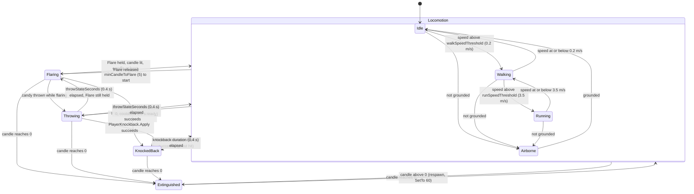
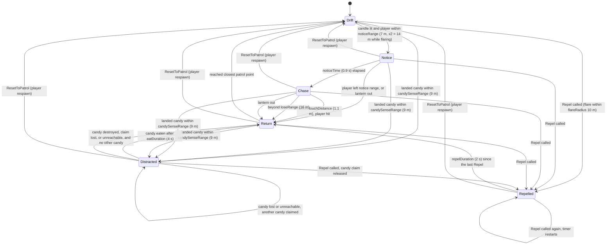
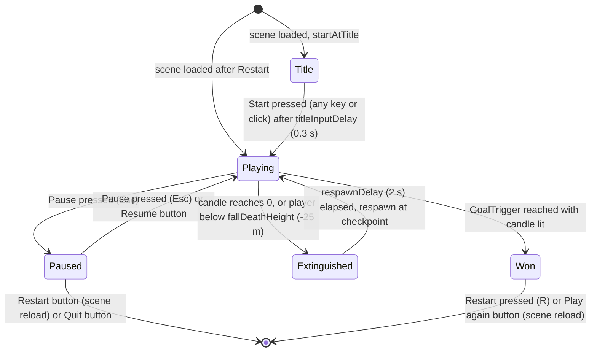

# Lantern Keeper: Finite State Machines

Three explicit state machines drive the game. Each is an `enum` plus a single place in code where transitions happen, so the diagrams below can be checked line by line against the scripts. Values in parentheses are the default Inspector values at the time of writing.

| FSM | Enum | Script |
|---|---|---|
| Player | `PlayerState` | `Assets/_Project/Scripts/Player/PlayerStateTracker.cs` |
| Ghost | `GhostState` | `Assets/_Project/Scripts/Enemies/GhostAI.cs` |
| Game mode | `GameMode` | `Assets/_Project/Scripts/Core/GameManager.cs` |

Press **F1** in the Editor or a Development Build to see all three live (`DebugOverlay`).

---

## 1. Player FSM

`PlayerStateTracker` does not move the player. Every `LateUpdate` it calls `Evaluate()`, which returns the **highest-priority state whose condition is true**, and raises `OnStateChanged(previous, next)` when the result changes. Because the state is re-derived each frame, any state can be followed by any other; the diagram shows the transitions that carry meaning.

Priority, highest first: **Extinguished > KnockedBack > Throwing > Flaring > Airborne > Running > Walking > Idle**.

"Locomotion" is not a state in code; it groups Idle, Walking, Running and Airborne, which the player drops back into according to grounding and speed.

### Player transition table

All transitions are decided in `PlayerStateTracker.Evaluate()` and applied in `PlayerStateTracker.LateUpdate()`. The "Condition source" column says which component supplies the fact.

| From | To | Condition | Code location |
|---|---|---|---|
| Any | Extinguished | `CandleManager.IsLit` is false (candle is 0) | `PlayerStateTracker.Evaluate` (1st check); value from `CandleManager.Apply` |
| Extinguished | Idle / Walking / Running / Airborne | Candle above 0 again (`GameManager.Respawn` calls `SetTo`) | `PlayerStateTracker.Evaluate` |
| Any except Extinguished | KnockedBack | `PlayerKnockback.IsKnockedBack` (set by `Apply`, lasts `duration` 0.4 s) | `PlayerStateTracker.Evaluate` (2nd check); `PlayerKnockback.Apply` |
| KnockedBack | lower-priority state | Knockback timer ran out | `PlayerStateTracker.Evaluate`; `PlayerKnockback.Update` |
| Idle / Walking / Running / Airborne / Flaring | Throwing | `CandyThrower.IsThrowing` (a throw succeeded; lasts `throwStateSeconds` 0.4 s) | `PlayerStateTracker.Evaluate` (3rd check); `CandyThrower.TryThrow` |
| (none) | (no change) | Dropping a candy (G, `CandyThrower.TryDrop`) does **not** enter Throwing; the player stays in their current state | `CandyThrower.TryDrop` |
| Throwing | Flaring or locomotion | Throw window ran out | `PlayerStateTracker.Evaluate`; `CandyThrower.Update` |
| Idle / Walking / Running / Airborne | Flaring | `LanternController.IsFlaring` (Flare held, lit, candle at least `minCandleToFlare` 5 to start) | `PlayerStateTracker.Evaluate` (4th check); `LanternController.Update` |
| Flaring | locomotion | Flare released, or candle reached 0 | `PlayerStateTracker.Evaluate`; `LanternController.Update` |
| Idle / Walking / Running | Airborne | `ThirdPersonController.Grounded` is false | `PlayerStateTracker.Evaluate` (5th check) |
| Airborne | Idle / Walking / Running | `ThirdPersonController.Grounded` is true | `PlayerStateTracker.Evaluate` |
| Idle / Walking | Running | Horizontal speed above `runSpeedThreshold` (3.5 m/s) | `PlayerStateTracker.Evaluate` (6th check) |
| Idle | Walking | Horizontal speed above `walkSpeedThreshold` (0.2 m/s) | `PlayerStateTracker.Evaluate` (7th check) |
| Running | Walking | Speed at or below 3.5 m/s and above 0.2 m/s | `PlayerStateTracker.Evaluate` |
| Walking / Running | Idle | Speed at or below 0.2 m/s | `PlayerStateTracker.Evaluate` (fallback) |

---

## 2. Ghost FSM

`GhostAI` holds one `GhostState` and changes it only through `ChangeState(next)`, which raises `OnStateChanged(ghost, previous, next)` and the static `GhostAI.AnyStateChanged`. Each state has a `Tick…` method called from `Update()`.

A ghost can hurt the player **only in Chase**. Tints: Drift and Return green, Notice yellow, Chase red, Repelled white, Distracted pink.

### Ghost transition table

| From | To | Condition | Code location |
|---|---|---|---|
| Drift | Notice | `CanNoticePlayer()`: candle lit AND distance at most `noticeRange` (7 m) x `flareNoticeMultiplier` (2, only while `LanternController.IsFlaring`) AND, if `lineOfSightBlockers` is set, an unblocked line at `eyeHeight` (1.2 m) | `GhostAI.TickDrift` |
| Notice | Chase | Time in state at least `noticeTime` (0.9 s) | `GhostAI.TickNotice` |
| Notice | Return | `CanNoticePlayer()` became false (out of range, lantern out, or sight blocked) | `GhostAI.TickNotice` |
| Chase | Return | Player missing or candle not lit | `GhostAI.TickChase` |
| Chase | Return | Distance above `loseRange` (16 m) | `GhostAI.TickChase` |
| Chase | Return | Distance at most `touchDistance` (1.1 m). `PlayerKnockback.Apply` is called first; if it returns true the candle loses `ghostHitDamage` (20) and `GameEvents.PlayerHit` fires. The ghost returns either way | `GhostAI.TickChase` |
| Return | Drift | Arrived at the closest patrol point (within stopping distance + `arriveTolerance` 0.35 m). With no patrol points: arrived at the start position | `GhostAI.TickReturn` |
| Drift, Notice, Chase, Return | Distracted | Every `candySearchInterval` (0.3 s): `Candy.FindClosestAvailable` finds landed, unclaimed candy within `candySenseRange` (9 m) and `Claim` succeeds | `GhostAI.Update` (`TryClaimCandy`) |
| Distracted | Return | Reached the candy (within `eatDistance` 0.5 m), ate for `eatDuration` (4 s), `Candy.Consume` | `GhostAI.TickDistracted` |
| Distracted | Return | Candy destroyed or claim no longer ours, and no other candy to claim | `GhostAI.TickDistracted` |
| Distracted | Return | Path ended more than `eatDistance` from the candy (after 0.5 s in state), and no other candy to claim | `GhostAI.TickDistracted` |
| Distracted | Distracted (restart) | Either of the two cases above, but another candy was claimed | `GhostAI.TickDistracted` (`EnterState`) |
| Any | Repelled | `Repel(sourcePosition)` called (the flare calls it about 5 times a second for ghosts within `flareRadius` 10 m). Leaving Distracted releases the candy claim | `GhostAI.Repel`, `GhostAI.ChangeState` |
| Repelled | Repelled (timer restart) | `Repel` called again: timer back to `repelDuration` (2 s); flee point re-aimed at most every 0.4 s | `GhostAI.Repel` |
| Repelled | Return | `repelDuration` (2 s) passed since the last `Repel` | `GhostAI.TickRepelled` |
| Any | Drift | `ResetToPatrol()`: warped to the start position, patrol restarted (called by `GameManager.Respawn`) | `GhostAI.ResetToPatrol` |

Notes that match the code:
- **Repelled cannot be interrupted by candy**: the candy search in `Update` is skipped in Repelled and Distracted.
- **Return does not notice the player.** Only Drift does, so a ghost that has just hit the player walks home before it can notice again.
- Inside Drift the ghost waits `waypointWait` (1.5 s) at each waypoint (`TickDrift`); this is not a state change.
- Speeds per state: Drift 1.6, Chase 3.6, Repelled 4.5, Distracted 2.8, Return 2.2 m/s (`EnterState`).
- A chasing ghost re-paths every `repathInterval` (0.25 s), not every frame (`TickChase`).

---

## 3. Game mode FSM

`GameManager` holds one `GameMode` and changes it only through `SetMode(next)`, which raises `OnModeChanged(previous, next)`. The overview's **Exploration**, **Evasion** and **Puzzle** modes are all `Playing`; Evasion is the flag `GameManager.IsEvasion` (any ghost in Notice or Chase), raised through `OnEvasionChanged`.

### Game mode transition table

| From | To | Condition | Code location |
|---|---|---|---|
| (scene load) | Title | `startAtTitle` is true and this load was not caused by `Restart()` | `GameManager.Start` |
| (scene load) | Playing | `startAtTitle` is false, or the scene was reloaded by `Restart()` | `GameManager.Start` |
| Title | Playing | `Start` action pressed (any key or left click) at least `titleInputDelay` (0.3 s, unscaled) after loading | `GameManager.Update` -> `StartGame` |
| Playing | Paused | `Pause` action pressed (Esc) | `GameManager.Update` -> `Pause` |
| Paused | Playing | `Pause` action pressed (Esc), or the Resume button | `GameManager.Update` -> `Resume`; `GameMenus.HandleResume` |
| Playing | Extinguished | `CandleManager.OnExtinguished` (candle reached 0). Also raised when the player falls below `fallDeathHeight` (-25 m), which sets the candle to 0 | `GameManager.HandleExtinguished`; fall check in `GameManager.Update` |
| Extinguished | Playing | `respawnDelay` (2 s) elapsed: `Respawn()` teleports to the last checkpoint (or the start), sets the candle to at least `minCandleOnRespawn` (60%), resets knockback and every ghost, clears landed candy, raises `GameEvents.PlayerRespawned` | `GameManager.Update` -> `Respawn` |
| Playing | Won | `GoalTrigger.OnTriggerEnter` with the candle lit calls `Win()`; raises `GameEvents.LevelCompleted` | `GoalTrigger.OnTriggerEnter` -> `GameManager.Win` |
| Paused | scene reload | Restart button | `GameMenus.HandleRestart` -> `GameManager.Restart` |
| Won | scene reload | `Restart` action pressed (R), or the Play again button | `GameManager.Update` -> `Restart`; `GameMenus.HandleRestart` |
| Paused | quit | Quit button | `GameMenus.HandleQuit` -> `GameManager.Quit` |

### What each mode sets (`GameManager.EnterMode`)

| Mode | Time scale | Candle drain | Player movement and input | Cursor | Play time counts |
|---|---|---|---|---|---|
| Title | 0 | paused | off | free | no |
| Playing | 1 | running | on (one frame after entering) | locked | yes |
| Paused | 0 | paused | off | free | no |
| Extinguished | 1 | n/a (candle is 0) | off | locked | yes |
| Won | 0 | paused | off | free | no |
