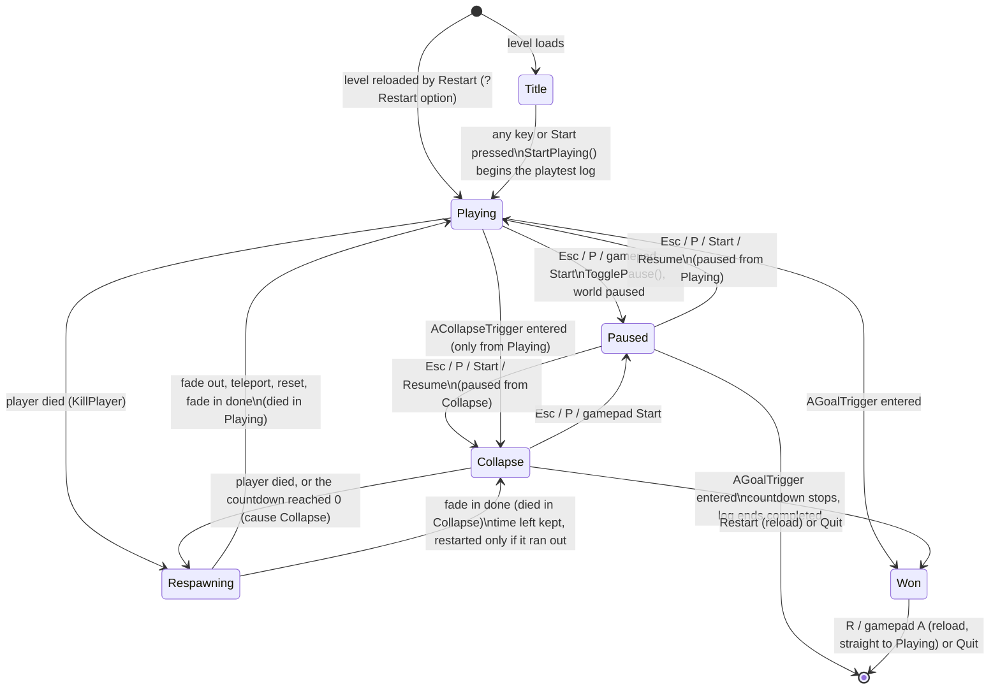
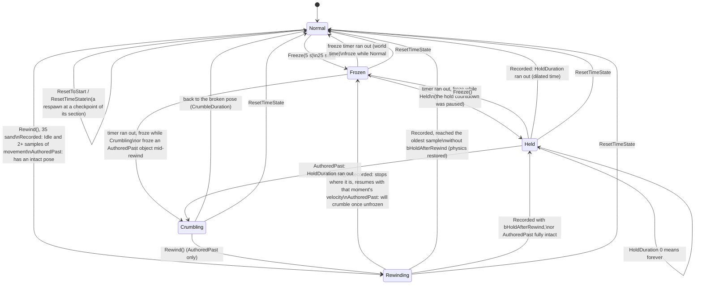

# State machines

Both diagrams are read from the code: the game mode in `Source/Stopwatch/StopwatchGameMode.cpp` (`EStopwatchMode`), and the time states in `Source/Stopwatch/TimeableComponent.cpp`.

## Game mode

Every transition goes through `AStopwatchGameMode::SetMode`, which logs `Game mode: Old -> New` and broadcasts `OnModeChanged`. The player controller shows the right screen, cursor and input for each mode.

What each mode allows:

| Mode | Pawn input | Freeze/Rewind | Deaths count | Cursor | Screen |
|---|---|---|---|---|---|
| Title | off | off | no | shown | title, premise, controls |
| Playing | on | on | yes | hidden | HUD |
| Paused | (world paused) | off | no | shown | Resume / Restart / Quit, log folder |
| Respawning | off | off | no | hidden | HUD with the death cause, fading |
| Collapse | on | on | yes | hidden | HUD with the countdown |
| Won | off | off | no | shown | stats, R / A to play again, Quit, log folder |

The respawn: fade out for `RespawnFadeSeconds` (0.75) showing the cause, then teleport to the last checkpoint (or the PlayerStart before one), stop all movement, face the checkpoint's yaw, reset every `IResettable` whose `SectionId` is the checkpoint's, top the sand up to the checkpoint's `MinSandOnRespawn`, then fade in for another 0.75 s.

## Time states of a timeable object

`UTimeableComponent` keeps `bIsFrozen` beside a phase (`Idle`, `Rewinding`, `Holding`, `Crumbling`). Frozen is shown as its own state here. Unfreezing goes back to the phase the object froze in, because freezing only stops the owner's time (`CustomTimeDilation = 0`). Normal is the `Idle` phase, and Held is `Holding`.

Where each piece sits: pendulums, crushers, gears, moving platforms, props and chutes use `Recorded`. The falling platform uses `Recorded` with `bHoldAfterRewind` and `HoldDuration` 0, so it stays up. Broken bridges use `AuthoredPast`, with `HoldDuration` 0 (stays) or a few seconds (crumbles again).
